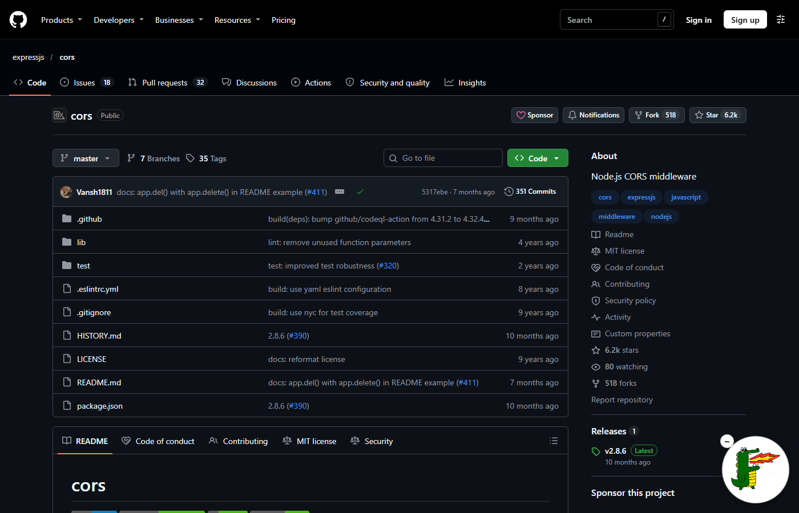
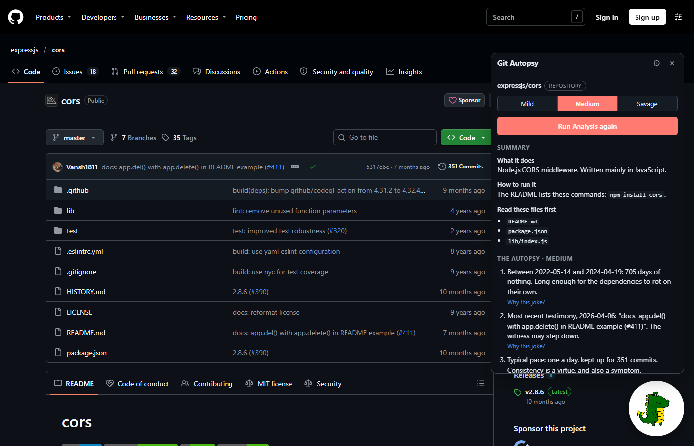

# GitDragon (Git Autopsy)

A Chrome extension for github.com. A small dragon sits in the corner of every **repository** and **profile** page.

- **Hover** over it: it breathes fire.
- **Click** it: it breathes fire, then a box opens with:
  1. **Summary**: what the project does, how to run it, which files to read first (or, for a profile, what this developer mostly builds).
  2. **The Autopsy**: 3-5 dark, deadpan roast lines built only from real facts about that exact repo or profile. Pick **Mild / Medium / Savage**, and click **"Why this joke?"** under any line to see the evidence behind it.
  3. **Evidence**: every fact, each with a link to the GitHub API URL it came from, so you can check it yourself.
  4. **Share**: download a share image, or copy a link to a public page with the roast and its evidence.

> **Facts first, jokes second.** Our own code measures everything (commit gaps, languages, missing tests...). The AI only gets that list of verified facts, is not allowed to invent numbers, and its answer is checked by code before you see it.



*(Screenshot placeholders: add your own PNGs to `docs/screenshots/`.)*

---

## Install it (for friends: no setup needed)

You need **Google Chrome** (or Edge / Brave). You do **not** need Node.js or any keys.

1. Download **`git-autopsy-extension.zip`** (from whoever shared it with you, or from the repo's Releases page).
2. **Unzip it**: right-click the file, then **Extract All...** You get a folder.
3. Open Chrome and go to **`chrome://extensions`**
4. Turn on **Developer mode** (switch in the top-right corner).
5. Click **Load unpacked** and select the **unzipped folder** (the one that contains `manifest.json`).
6. Open any GitHub repo, for example https://github.com/expressjs/cors
7. Hover the dragon in the bottom-right corner, then click it, then **Run Analysis**.

Tips: drag the dragon to any corner. The small **–** button hides it for the rest of the session. The gear icon in the box has an **Auto-run** setting.

---

## How it works

```
 github.com (repo or profile page)
 ┌──────────────────────────────────────────────┐
 │  content.js + dragon.js   (Shadow DOM)       │   hover = fire, click = fire + box
 │  idle/fire videos from extension/mascot/     │
 └───────────────┬──────────────────────────────┘
                 │ chrome.runtime message
 ┌───────────────▼──────────────────────────────┐
 │  background.js (service worker)              │   no secrets in the extension
 │  adds an anonymous random install ID         │
 └───────────────┬──────────────────────────────┘
                 │ HTTPS  GET /repo/:owner/:name?intensity=
 ┌───────────────▼──────────────────────────────┐      ┌──────────────────────────┐
 │  Backend (Express) on Vercel (free)          │─────▶│ Supabase (free):         │
 │  1. last-updated marker from GitHub          │◀─────│  cached results (expiry) │
 │  2. cache hit? return it (no AI call)        │      │  daily usage counters    │
 │  3. daily limit per install (hashed ID)      │      └──────────────────────────┘
 │  4. facts engine (plain code) ── GitHub API  │
 │  5. comedy engine: cards -> AI writer ->     │─────▶ Gemini / Groq / OpenRouter
 │     AI critic -> code checks (or offline)    │       (key lives ONLY on the server)
 └──────────────────────────────────────────────┘
```

| Folder / file | What it does |
|---|---|
| `extension/` | The Chrome extension (Manifest V3, plain JavaScript, no external scripts) |
| `extension/dragon.js` | The mascot: idle/fire videos, hover, drag to a corner, minimize, reduced motion |
| `extension/content.js` | The analysis box (summary, roast, "Why this joke?", evidence, share), follows GitHub's page changes |
| `extension/background.js` | Talks to the backend; the backend URL is set by `npm run package` |
| `extension/mascot/` | `dragon-idle.mp4` and `dragon-fire.mp4` (see "Mascot videos" below) |
| `api/index.js` + `vercel.json` | The Vercel entry point (the same Express app) |
| `src/server.js` | Routes: `/repo`, `/profile`, `/cache` (delete), `/share/:id`, `/health` |
| `src/service.js` | Caching, daily limits, AI-quota fallback |
| `src/store.js` + `supabase/schema.sql` | Supabase cache and usage counters (or memory, locally) |
| `src/githubClient.js` | GitHub API: token, ETag disk cache, expired-token fallback, error handling |
| `src/facts/`, `src/collectors/` | **Facts engine**: raw GitHub data to checkable facts (no AI) |
| `src/comedy/` | **Comedy engine**: angle detector, evidence cards, two-pass AI, automatic joke checks, offline templates |
| `src/aiProvider.js` | The only file that talks to an AI model (Gemini, Groq, OpenRouter, Ollama) |
| `scripts/` | smoke, comedy, accuracy, e2e, browser-check, fresh-install, package |

---

## Run it yourself (developers)

You need **Node.js 18+** and **Chrome**.

```bash
git clone https://github.com/Shrexxx-sys/Gitdragon.git
cd Gitdragon
npm install
cp .env.example .env        # Windows PowerShell: Copy-Item .env.example .env
npm test                    # all tests, no internet or keys needed
npm start                   # -> http://localhost:3000/health
```

Then load the **`extension`** folder with **Load unpacked** (steps 3-5 above). The unpacked source talks to `http://localhost:3000`.

All keys are optional and go in **`.env`** (never in `.env.example`, which is committed to git):

| Key | Why | Where to get it (free) |
|---|---|---|
| `GITHUB_TOKEN` | 5000 GitHub requests/hour instead of 60, plus TODO counts | https://github.com/settings/tokens (no scopes needed) |
| `GEMINI_API_KEY` | AI summary + roast | https://aistudio.google.com/apikey |
| `GROQ_API_KEY` | Alternative AI (fast) | https://console.groq.com/keys |
| `OPENROUTER_API_KEY` | Alternative AI (free models end in `:free`) | https://openrouter.ai/keys |

Without an AI key everything still works, using the built-in offline roast (still fact-based, same checks).

---

## Ship it for everyone (free tiers)

**Host: Vercel.** The backend is a normal Express app, and Vercel runs an Express app as a serverless function with a 3-line wrapper (`api/index.js`). Cloudflare Workers or Supabase Edge Functions would need the server rewritten for a different runtime. **Cache: Supabase** (free Postgres, used through its REST API, no extra library).

### 1. Supabase (cache + daily limits)
1. Create a free project at https://supabase.com (any region).
2. **SQL Editor**, then **New query**: paste all of `supabase/schema.sql`, then **Run**.
3. **Project Settings > API**: copy the **Project URL** and the **service_role** key (keep it secret: it only ever goes into Vercel).

### 2. Vercel (the backend)
1. Push this repo to GitHub (already done), then go to https://vercel.com, **Add New... > Project**, and import `Gitdragon`.
2. Framework preset: **Other**. No build command needed.
3. **Environment Variables** (Production):

| Name | Value |
|---|---|
| `GEMINI_API_KEY` | your Gemini key |
| `GEMINI_MODEL` | `gemini-3.5-flash-lite` (fast and reliable on the free tier) or `gemini-3.5-flash` |
| `GITHUB_TOKEN` | a GitHub token (no scopes) |
| `SUPABASE_URL` | the Supabase Project URL |
| `SUPABASE_SERVICE_KEY` | the Supabase service_role key |
| `HASH_SALT` | any long random text (used to hash install IDs) |
| `AI_DAILY_LIMIT` | optional, default `20` AI analyses per install per day |
| `HARD_DAILY_LIMIT` | optional, default `150` analyses per install per day |

4. **Deploy.** Open `https://<your-app>.vercel.app/health`: you should see `"store": "supabase"` and your AI model.
5. Test it end to end: `BACKEND_URL=https://<your-app>.vercel.app npm run e2e`

### 3. The extension zip for your friends
```bash
npm run package -- --backend https://<your-app>.vercel.app
```
This creates `dist/git-autopsy-extension.zip` with your backend URL inside. Share that file (or attach it to a GitHub Release). Check it in a real browser with `EXT_DIR` pointing at the unzipped folder: `npm run browser-check`.

**Cost:** Vercel Hobby, Supabase Free and the Gemini free tier cost **$0**. The per-install daily limits and the cache keep you inside the free quotas. When the AI quota runs out, users still get facts, the summary and the offline roast, with a note.

### Optional: Chrome Web Store
Friends can always use **Load unpacked**. To publish properly:
1. Register at https://chrome.google.com/webstore/devconsole (one-time **$5** fee).
2. Run `npm run package -- --backend https://<your-app>.vercel.app` and upload `dist/git-autopsy-extension.zip`.
3. Fill in the listing: description, screenshots (1280×800), a 128×128 icon (`extension/icons/icon128.png`), and a privacy policy (the "Privacy" section below works). Permission justifications: `storage` (settings), host access to github.com (show the dragon) and to your backend (run the analysis).
4. Submit for review (usually a few days).

---

## Privacy

- Only **public GitHub data** is read (the same things anyone sees on github.com).
- The extension creates a **random install ID** (not linked to you or your GitHub account). The server stores only a **salted hash** of it, to count analyses per day. Usage rows can be deleted after a few days (see `supabase/schema.sql`).
- **No** names, emails, IP addresses, browsing history or GitHub logins are stored. Nothing is sold or shared.
- Cached analyses (public data only) expire after 7 days. Anyone can delete the cached result of a repo or profile with the **"Delete cached result"** button in the box (or `DELETE /cache/repo/:owner/:name`, `DELETE /cache/profile/:username`).
- The AI key and GitHub token live only on the server, never in the extension.

---

## The comedy engine

**Style:** dark, deadpan, situational. A specific fact, then an unexpected twist, in one or two sentences. Abandoned projects get "death certificate" energy; active ones get absurd precision.

**The LIMIT (enforced in the prompt AND by code):** jokes are only about public code, repo and habit data. Never the person's identity, appearance, health, mental health, family, nationality or personal life. The comedy model never sees the user's bio or name, only the evidence cards.

1. **Angle detector** (`src/comedy/angles.js`) finds roastable patterns and ranks them: abandonment, `"final"`/`"final2"` commits, 1-5 AM commits (local time), 200 commits in one day then silence, 40 forks vs 3 originals, a README that only repeats the title, TODOs without tests, a repo named `test3`, tutorial clones, perfect docs with 0 stars, committed `node_modules`/`.env`, and more. There is **always** an angle: a spotless repo gets "suspiciously clean".
2. **Evidence cards**: `{ angle, fact, number, source_url, exact_quote }`.
3. **Pass 1** writes 10 candidates in the tone of `calibration.md`; **pass 2** (a critic) keeps and sharpens the best 3-5.
4. **Automatic checks** (`src/comedy/checks.js`): each joke must cite a card and include its exact detail. Clichés, famous-people comparisons, explaining the joke, "Ah"/"Well" openings, emoji spam, invented numbers, LIMIT topics and repeated openings are all rejected.

**Calibration:** put 10-20 of your own jokes in `calibration.md` (one per line, starting with `- `). They're tone examples only. The file currently holds **placeholders**; `/health` reminds you.

**Models:** set `AI_PROVIDER` (summary) and `HUMOR_PROVIDER` + `HUMOR_MODEL` (roast) in `.env`. Gemini, Groq, OpenRouter and Ollama (local, no key: `ollama pull llama3.2`) are supported. Compare two models on the same 15 targets:
```bash
npm run comedy -- --models gemini:gemini-3.6-flash,gemini:gemini-3.5-flash-lite
```

---

## Mascot videos

`extension/mascot/dragon-idle.mp4` (mouth closed, loops) and `dragon-fire.mp4` (breathing fire). They're shown in a round frame, styled by the CSS variables at the top of `extension/dragon.js` (`--mascot-size`, `--mascot-frame-*`, `--mascot-fit`).

**Transparent dragon later:** add `dragon-idle.webm` and `dragon-fire.webm` (VP9 with alpha) next to the MP4s. The extension prefers WebM automatically and removes the frame. **No code changes**, just replace or add the files.

Keep each video under ~5 MB. Both videos are preloaded so hover is instant.

---

## Tests

```bash
npm test               # 119 unit/integration tests: no internet, no keys (saved GitHub data + fake AI)
npm run smoke          # full pipeline on 5 real repos + 5 real profiles
npm run comedy         # comedy engine on 15 real targets -> comedy-report.md
npm run accuracy       # facts engine vs GitHub's GraphQL API on 50 targets -> accuracy-report.md (needs GITHUB_TOKEN)
npm run e2e            # end-to-end against BACKEND_URL, or a local simulation of the Vercel function
npm run browser-check  # the real extension in Chrome for Testing on real github.com (once: npx puppeteer browsers install chrome)
npm run fresh-install  # follows this README in an empty folder, then installs the zip in Chrome like a friend
```

- **Dragon** (jsdom): idle, hover and back, click (fire, then box), run analysis, loading, errors, close, minimize, drag to a corner, auto-run, reduced motion, dark mode, nothing injected on other pages.
- **Backend**: cache with last-updated marker, daily limits, hashed IDs, AI-quota fallback and circuit breaker, expired token, cache delete, share pages (escaped), broken store, Supabase store against a fake Supabase server.
- **Facts / comedy / extension**: see `test/`.

---

## Error messages in the box

| Situation | What you see |
|---|---|
| Private, deleted or misspelled repo/user | "Not found (or private)" |
| GitHub rate limit | "GitHub rate limit reached" + reset time |
| Server's GitHub token expired | Works on the public limit + a note; "GitHub token expired" only if GitHub refuses completely |
| Your daily AI allowance used up | Full analysis with the offline roast + a friendly note |
| Daily analysis limit reached | "Daily limit reached", resets at midnight UTC |
| AI out of quota / failing | Facts + summary + offline roast + a note saying why |
| Backend unreachable | "Backend not reachable" (local: "run npm start") |

---

## Honest limitations

- "Open issues" from GitHub includes open pull requests (the box says so).
- Commit patterns use the **latest 100 commits**; the total commit count is exact.
- Profile "quiet periods" are estimated from repo dates and ~90 days of public events.
- Profiles with more than 300 repos: only the 300 most recently pushed are analysed (the box says so).
- TODO counts need a GitHub token (code search) and are skipped without one.
- The LIMIT word filter is a safety net; the prompt and the critic handle the rest.
- Free AI tiers run out: then the roast comes from the offline templates until the quota resets.
